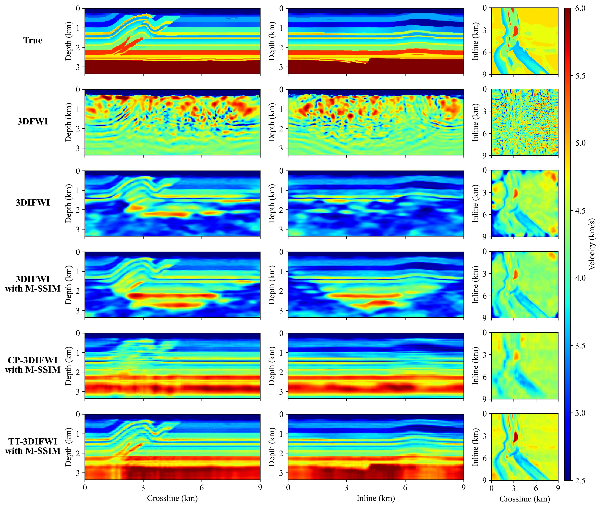

# TT-3DIFWI

## Tensor Train Decomposition-Based 3D Implicit Full-Waveform Inversion

Three-dimensional full-waveform inversion (3DFWI) is a powerful technique for reconstructing high-resolution subsurface velocity models. However, its practical application is often limited by high memory requirements, substantial computational cost, and sensitivity to cycle skipping.

> **Publication status:** The manuscript describing the proposed TT-3DIFWI method has been submitted to *Geophysics* and is currently under peer review.

This project implements **TT-3DIFWI**, a three-dimensional implicit full-waveform inversion framework that combines:

- **Tensor Train (TT) decomposition**
- **Implicit Neural Representation (INR)**
- **Multi-Scale Structural Similarity (M-SSIM) objective function**

The 3D velocity model is represented implicitly using a series of low-rank TT core tensors. This compact parameterization reduces the memory consumption of INR training while preserving the accuracy and spatial resolution of the reconstructed velocity model.

The low-rank structure introduced by TT decomposition also acts as a structural constraint, improving the continuity and consistency of the inversion result. Meanwhile, the M-SSIM objective function measures structural differences between predicted and observed seismic data at multiple scales. It helps recover large-scale and ultra-low-frequency information and reduces the risk of cycle skipping.

## Method Overview

The TT-3DIFWI workflow consists of three main components:

1. **Tensor Train decomposition**

   The high-dimensional representation of the 3D velocity model is decomposed into a sequence of low-rank core tensors.

2. **Implicit neural representation**

   An implicit neural network maps spatial coordinates to velocity values. The network representation is compressed using the TT format to reduce the number of trainable parameters and memory consumption.

3. **M-SSIM objective function**

   Multi-scale structural similarity is used to compare the predicted and observed seismic data. Unlike a point-by-point waveform difference, M-SSIM emphasizes structural information across multiple scales and improves inversion robustness when low-frequency data are unavailable.

## Tensor Train Decomposition

A high-dimensional tensor can be represented in the Tensor Train format as a product of low-order core tensors:

```text
V(i₁, i₂, ..., iₙ) ≈ G₁(i₁) G₂(i₂) ... Gₙ(iₙ)
```

Here, `G₁, G₂, ..., Gₙ` are the TT cores, and the dimensions connecting adjacent cores are known as the **TT ranks**.

Instead of storing and optimizing a complete dense tensor, TT-3DIFWI only stores and updates these low-rank cores. When suitable TT ranks are selected, this representation provides:

- Lower memory consumption
- Compact storage of the 3D velocity model
- Structural regularization through the low-rank constraint
- Improved spatial continuity in the reconstructed model
- Scalability to larger three-dimensional problems

The TT rank controls the balance between compression and representation capacity. A low TT rank provides stronger compression, while a higher rank can represent more complex geological structures at an increased memory and computational cost.

## M-SSIM Objective Function

Conventional FWI commonly minimizes an L1 or L2 waveform difference. These point-wise objective functions can be highly sensitive to phase mismatches and cycle skipping, especially when the starting model is inaccurate or low-frequency seismic data are missing.

The M-SSIM objective function compares the structural similarity between predicted and observed seismic data at multiple scales. It considers characteristics such as:

- Local amplitude
- Contrast
- Structural pattern
- Multi-scale waveform features

By progressively comparing structural information at different scales, M-SSIM provides useful large-scale information for the early inversion stages and improves the recovery of detailed structures during later iterations.

## Inversion Workflow

The main inversion procedure is:

1. Load the reference velocity model and acquisition geometry.
2. Generate or load the observed seismic data.
3. Initialize the TT cores and implicit neural representation.
4. Reconstruct the current 3D velocity model from the TT representation.
5. Simulate seismic wave propagation through the current model.
6. Compare the predicted and observed seismic data using M-SSIM.
7. Backpropagate the gradient through the wave simulator and INR.
8. Update the TT cores and neural network parameters.
9. Repeat the process until the objective function converges.

## Project Structure

```text
TT-3DIFWI/
├── deepwave3D/                 # Differentiable 3D wave propagation
├── misfit/                     # Waveform misfit and objective functions
├── utils/                      # Data processing and utility functions
├── IFWI3D_checkpoint_TT.ipynb  # Main TT-3DIFWI notebook
├── siren.py                    # Implicit neural representation
├── True.mat                    # Reference velocity model
├── result.jpg                  # Example inversion result
└── README.md                   # Project documentation
```

## Requirements

The project requires Python and common scientific computing libraries, including:

- Python
- PyTorch
- NumPy
- SciPy
- Matplotlib
- Jupyter Notebook

A CUDA-enabled GPU is strongly recommended because 3D wavefield simulation and gradient calculation require substantial computation and memory.

## Usage

Start Jupyter Notebook:

```bash
jupyter notebook
```

Open:

```text
IFWI3D_checkpoint_TT.ipynb
```

Before running the inversion, configure:

- Velocity model dimensions
- Spatial grid spacing
- Temporal sampling interval
- Source wavelet
- Source and receiver geometry
- Number of inversion iterations
- TT ranks
- Neural network parameters
- M-SSIM scale settings
- Learning rate and optimization parameters
- Data and output paths

## Inversion Result

The following figure presents an example result produced by the TT-3DIFWI framework.



The result demonstrates the ability of the TT-based implicit representation to reconstruct continuous subsurface structures while maintaining a compact model parameterization.

## Advantages

TT-3DIFWI provides several potential advantages:

- Compact representation of large 3D velocity models
- Reduced memory consumption during INR training
- Improved continuity through low-rank structural constraints
- Better tolerance to inaccurate initial models
- Reduced sensitivity to cycle skipping using M-SSIM
- Improved inversion when low-frequency data are missing
- High-resolution and structurally consistent reconstruction

## Notes

- Confirm that `True.mat` and all required seismic data are available before running the notebook.
- Carefully check the dimensions and axis order of every input array.
- Ensure that the grid spacing and time step satisfy the numerical stability conditions.
- The TT ranks should be selected according to the complexity and size of the velocity model.
- This implementation is intended for research and experimental use.

## Citation

If this repository contributes to your research, please cite the corresponding TT-3DIFWI work. Citation information will be added after publication.
